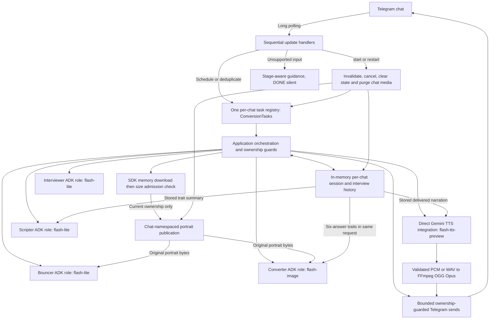
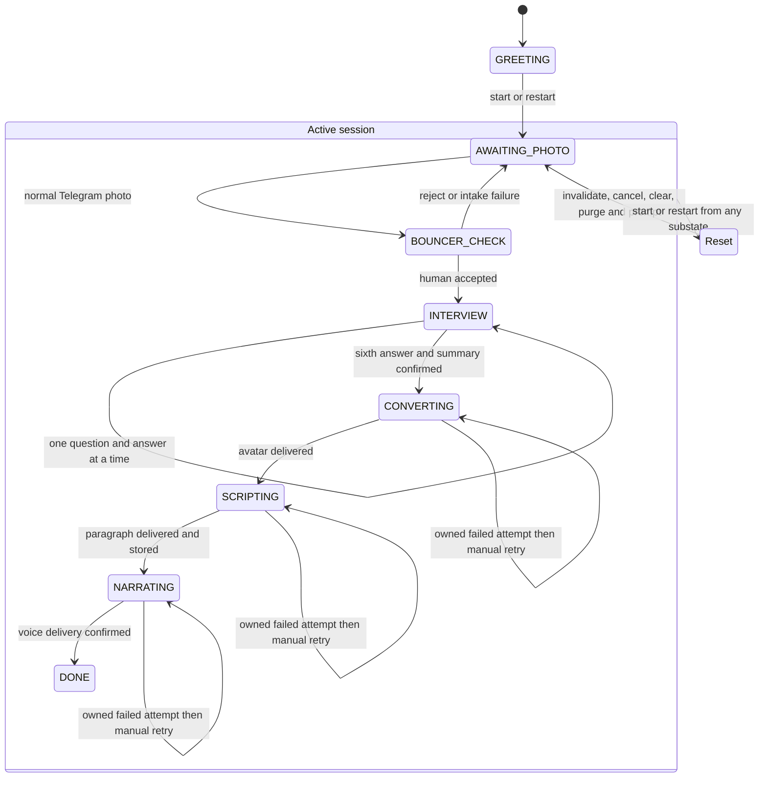

# Target architecture: submission readiness

These diagrams describe the readiness design, now implemented on the feature
branch and under final review. Reconciled diagrams also appear in SPECS/TECH.md,
linked from README. Local execution evidence and outstanding corrections are in
validation.md; native Codio and phone acceptance are pending. No ADK parent
orchestrator is claimed.

All four named agent roles use ADK LlmAgent/InMemoryRunner. Role invocations may
have fresh ADK sessions; durable conversation continuity within this bot process
comes from application-owned history supplied to each turn. Nothing persists
across a process restart. Exact model IDs stay those of the accepted baseline.

The composite Active box groups existing stages for the diagram, and Reset is a
reset operation; neither is a new Stage enum member. Interview failure does not record an answer or advance. DONE has no
non-reset outgoing action. Late/stale work is discarded, not a state transition.

## Ownership and delivery rules

- One active worker per chat; retired workers remain observable until completion.
- Intake worker continues Bouncer -> first question. Every accepted answer starts
  exactly one owned turn, including the sixth. The sixth-answer task continues
  summary -> Converter -> Scripter -> Narrator by direct nested awaits, with no
  second registry.start or replacement asyncio task.
- Before external send or local publication: verify version, expected stage,
  cancellation state and deadline. Check again after await before committing.
- No shared disk path is supplied to a still-running photo download. This prevents
  old downloads from recreating media after reset.
- Already accepted Telegram messages cannot be recalled. Lost acknowledgements
  can cause duplicate external delivery after a manual retry; no exactly-once claim.
- Reset must not wait for a model call. A malicious/non-cooperative dependency can
  outlive cancellation; keep results unusable and report unfinished shutdown work.
