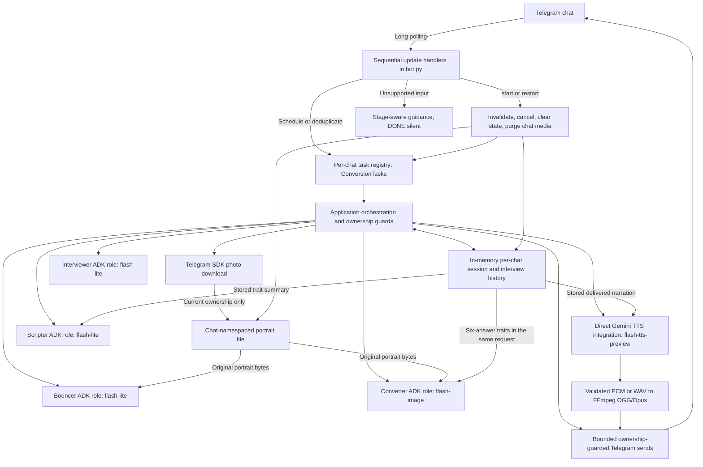
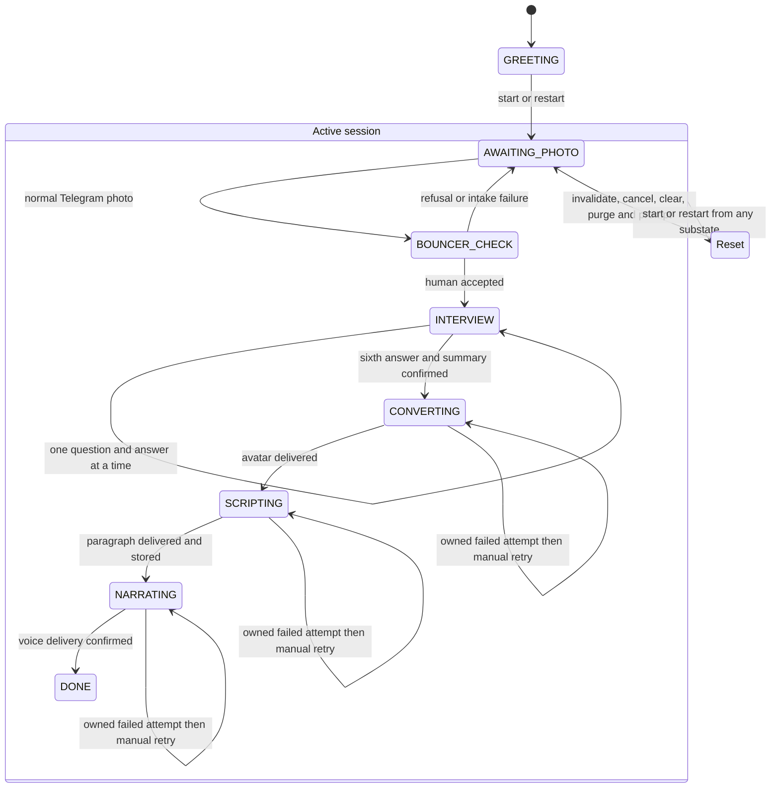

# TECH — Constraints and Architecture

## Runtime
Python 3.11+, running locally in Codio during development.

## Stack (use these, do not substitute)
- Telegram API via **`python-telegram-bot`** (v21+) using LONG POLLING, not webhooks. Rationale: long polling reaches outbound to Telegram over HTTPS, works behind NAT/firewall on localhost, needs no public IP, SSL cert, or ngrok. Do not implement a webhook server.
- Transports and contracts: Pydantic v2 models at the boundaries. `Settings` (loaded from `.env`, secrets held as `SecretStr`), `ChatInput` (a normalised, typed view of every inbound update, with `chat_id` normalised to `int`), and `SessionState` (per-chat stage, plus `interview: InterviewState | None`). Untrusted input is parsed/validated at the edge, never trusted raw.
  - **Interview contracts (Feature 3):** `InterviewQuestion(text)`, `InterviewAnswer(question, answer)`, `TraitSummary(summary, traits=[])`, and `InterviewState(answers, pending_question, summary)` with `record(answer)` pairing the pending question (fail loud if there is none). `SessionState.interview` is `None` until the interview starts; `InMemorySessionStore.reset` clears it.
- Google ADK (Agent Development Kit) to structure the pipeline as discrete specialized agents in a clear state machine, not ad-hoc chained API calls.
  - **In use (Feature 2):** the Bouncer is a real ADK `LlmAgent` (`gemini-3.1-flash-lite`, multimodal) behind a typed interface `Bouncer.inspect(image_path: Path) -> BouncerVerdict` (`app/bouncer.py`); `google-adk` is pinned in `requirements.txt`. The verdict is parsed via a Pydantic `output_schema` (schema, not regex). Unit tests inject a fake runner, so no network is used.
  - **In use (Feature 3):** the Interviewer is a real ADK `LlmAgent` (`gemini-3.1-flash-lite`) behind a typed interface `Interviewer` with `next_question(history) -> InterviewQuestion` and `summarise(history) -> TraitSummary` (`app/interviewer.py`). Both outputs are parsed via a Pydantic `output_schema` (schema, not regex). The fixed interview length is `TOTAL_QUESTIONS = 6`. The API key is held privately and never logged; `LazyInterviewer` builds the ADK delegate on first use (startup needs no key). Unit tests inject fake `question_runner`/`summary_runner` seams, so no network is used.
  - **In use (Feature 4):** the Converter is a real ADK `LlmAgent` (`gemini-3.1-flash-image`) behind a typed interface `Converter.generate_avatar(portrait_path: Path, summary: TraitSummary) -> bytes` (`app/converter.py`). It returns the raw image bytes and does **no** filesystem work (it never sees `chat_id`); the orchestrator writes those bytes to `avatar_dest(chat_id)` (`<chat dir>/avatar.png` or `avatar.jpg`, matching decoded PNG/JPEG). The API key is held privately and never logged, and `LazyConverter` builds the ADK delegate on first use. Unit tests inject a fake `runner`, so no network is used.
  - **Orchestrator seam (Features 3–4):** `app/orchestrator.py` owns the `INTERVIEW`-stage routing (`start_interview`, `handle_interview_update`) and drives progression: one question at a time, commit-only-on-success, `INTERVIEW -> CONVERTING` after the final answer. The `CONVERTING`-stage step (`handle_converting_update`) generates one avatar, writes then sends it, advances `CONVERTING -> SCRIPTING` on success, and deletes the generated file; any failure leaves the stage at `CONVERTING` for a retry. The photo send is the injected typed `SendPhotoFn = Callable[[int, Path, str], Awaitable[bool]]` built in `bot.py` over `safe_send_photo` (mirroring `safe_send_message`). `bot.dispatch` only delegates: it routes updates at `CONVERTING` to the step (retry/self-heal) and runs it once after the interview acknowledgement. `build_application` registers unknown-command handling behind `/start`/`/restart`, text and photos; the final `filters.ALL` fallback follows it for unsupported uploads. The Scripter now runs automatically after `SCRIPTING` (see Feature 5 below).
- Gemini 3.1 models:
  - Bouncer, Interviewer, Scripter: gemini-3.1-flash-lite
  - Converter: gemini-3.1-flash-image
  - Narrator: gemini-3.1-flash-tts-preview

## Secrets
Read TELEGRAM_BOT_TOKEN and GEMINI_API_KEY from .env via python-dotenv (`load_dotenv()`, then a Pydantic `Settings` model validates). Never hard-code, never log secret values. .env is git-ignored; .env.example documents the keys.

## Agents as a state machine

Four roles run on Google ADK (`LlmAgent` + `InMemoryRunner`): **Bouncer**,
**Interviewer**, **Converter** and **Scripter**. The **Narrator** is a direct
`google-genai` TTS integration, not a fifth ADK agent. Role count is not instance
count: the one Interviewer role builds separate `interviewer_question` and
`interviewer_summary` ADK agents (`app/interviewer.py`).

ADK executes the model calls only. There is **no ADK parent or orchestrator
agent**: plain application code owns stage transitions, the per-chat interview
history, deadlines and task ownership (`app/early_flow.py`, `app/orchestrator.py`, `app/bot.py`,
`app/conversion_tasks.py`, `app/session_store.py`). Every role invocation creates a
fresh ADK session, so conversation continuity comes from application-owned history
supplied on each turn; nothing survives a process restart.

- Bouncer (ADK agent, flash-lite multimodal): inspect uploaded image; confirm a human face. Reject non-human/absent-face with a humorous refusal and ask for another photo.
- Interviewer (ADK agent, flash-lite): ask 6 (`TOTAL_QUESTIONS`) pointed questions one at a time and synthesise a `TraitSummary` (`app/interviewer.py`). The multi-turn history lives on the per-chat session and is re-sent to each stateless ADK call; `app/early_flow.py` owns live interview turns and the `INTERVIEW -> CONVERTING` handoff; `bot.py` continues into `app/orchestrator.py` for later stages. The ADK agent does not orchestrate progression.
- Converter (ADK agent, flash-image): one native multimodal request carries the **original portrait bytes** (`types.Part.from_bytes`, `image/jpeg`) and the trait text in the same `types.Content`, under fixed `CONVERTER_INSTRUCTION`; there is no image-to-description-to-image model chain and no second model call (`app/converter.py`). The `CONVERTING` step in `app/orchestrator.py` writes the returned bytes to the chat's temp dir and sends them as a Telegram photo with a canned documentary caption (`CONVERTER_CAPTION`, plain text) via `safe_send_photo`, then advances to `SCRIPTING`.
- Scripter (ADK agent, flash-lite): authoritative British documentary-narrator persona; synthesize insights into ONE dramatic paragraph, max about 90 words, plain text only (no markdown, no stage directions, no emojis).
- Narrator (direct `google-genai` integration, NOT an ADK agent, flash-tts-preview, fixed `Charon` voice): read the stored paragraph aloud, validate the returned PCM/WAV, encode to OGG/Opus with FFmpeg, then send as a Telegram voice message (`app/narrator.py`, `app/audio_format.py`, `app/audio_encoding.py`).

## State machine stages (per chat)
GREETING to AWAITING_PHOTO to BOUNCER_CHECK to INTERVIEW (a fixed 6 questions, `TOTAL_QUESTIONS`, inside the 5-to-7 requirement) to CONVERTING to SCRIPTING to NARRATING to DONE.
/start and /restart from ANY stage cancel in-progress work, purge that chat's temp media, and re-ask for a photo (they advance to AWAITING_PHOTO).
Besides reset-to-GREETING, the only non-ordered move allowed is the Bouncer retry edge **BOUNCER_CHECK -> AWAITING_PHOTO** (a rejected photo returns the chat to awaiting a photo); every other non-ordered move stays illegal (`IllegalTransitionError`, fail loud).

## Pipeline diagrams

Component view. ADK runs the four model roles; the application owns routing,
ownership and state. (`telegram-arch.html` explains long polling versus webhooks
only; it is not this pipeline diagram.)

Stage view. The `Active session` box only groups the existing `Stage` values for
the diagram; it is not a new enum member. `Reset` is diagram-only in the same way —
in both diagrams above it denotes the `/start` and `/restart` reset action
(invalidate, cancel, clear state, purge media, prompt), not a `Stage` value; the
chat lands on the real stage `AWAITING_PHOTO`. Late or stale work is discarded, not
a transition.

A failed interview turn records no answer and does not advance. `DONE` has no
outgoing action except a reset.

## Resilience (point-bearing, do not skip)
1. /restart and /start full reset: cancel active session, purge all temp files for that chat (photo, PNG, audio), re-init orchestrator memory to AWAITING_PHOTO (the reset reply asks for a photo). Must work mid-interview, mid-generation, any stage. No process reboot ever.
2. Try/except around every external call (every Telegram send/receive and every Gemini call). On failure: friendly message, offer retry, keep the process alive. During the interview a Gemini failure returns a friendly retry and leaves the interview state **exactly** as it was (commit-only-on-success); during conversion a Gemini-image failure or a Telegram photo-send failure (`safe_send_photo`) returns a friendly retry, leaves the stage at `CONVERTING`, removes any generated file, and lets the next update retry. Converter and Telegram send failures log operation/chat ID/exception type only, never arbitrary exception text or tracebacks. Feature 7 also uses metadata-only logging in touched early-stage paths; SDK diagnostics remain outside that guarantee.
3. Edge cases (build these): photo sent during interview (gently redirect, no state change, no download); blank/whitespace answer (re-ask the current question, not recorded); unknown slash-command during interview (nudge to answer or `/restart`, not recorded); text sent during Bouncer/awaiting-photo (prompt for a photo); Gemini timeout/error (caught, user notified, retry offered).
4. Temp-media hygiene: namespace each chat's media by chat_id (portrait `photo.jpg`, generated avatar `avatar.png` or `avatar.jpg`); delete on completion AND on reset (`purge_chat_media` removes the whole chat directory).

## Testing
Gates: `scripts/test` (pytest) and `scripts/hooks` (ruff + mypy). Red/Green TDD via write-tests for pure logic (state transitions, prompt builders, reset logic). Mock external calls in unit tests; keep secrets out of tests. LLM calls exercised by manual phone testing.

## Out of scope
No web frontend, no webhook server, no database (in-memory per-chat state plus temp files is sufficient), no user accounts.

## Feature 4 hardening implementation
- `ConversionTasks` owns per-chat tasks; reset invalidates a monotonic session
  version before cancellation. `InMemorySessionStore.reset` also invalidates.
- The live Application always injects this registry. Sequential handlers and
  `concurrent_updates=1` are retained. The direct dispatch seam may be awaited
  without a registry for deterministic callers; it is not the live entry point.
- Session ownership is checked before work, after generation and after sending.
  Old tasks cannot send a new photo, commit a transition or clean newer media.
- `post_stop` cancels tracked tasks before Telegram shutdown; cancellation is
  not converted to a retry. A third-party coroutine that suppresses cancellation
  indefinitely cannot be forcibly terminated by asyncio; reset still invalidates
  its results. SDK calls must remain cooperative.
- Pillow is the one added dependency. Accept decoded PNG/JPEG only, with matching
  MIME, at most 10 MiB and 20 million pixels. Keep original bytes, no re-encoding.
- Generation deadline: 120 seconds. Photo-send deadline: 30 seconds.
- Filesystem failures use the same safe retry path. Finally cleanup only acts on
  the owning session. Cleanup failure after delivery does not roll back SCRIPTING.
- Feature 4 made no Scripter/Narrator changes. No model-ID changes. MISSION.md unchanged.

## Feature 5: Scripter implementation
- `app/scripter.py`: typed `Scripter.write_script(TraitSummary) -> NarrationScript`,
  `AdkScripter`, and `LazyScripter`; `gemini-3.1-flash-lite` with a fresh ADK
  session for every generation. No tools, image analysis or new dependencies.
- Fixed instructions keep traits as labelled untrusted JSON data. Output persona:
  authoritative British nature documentary, grand, affectionate, lightly humorous,
  PG. No personal-fact invention or assumptions about the avatar's exact species.
- Strict `NarrationScript.text`: trim outside whitespace, 1–90 whitespace-separated
  words, one paragraph, no Markdown/HTML, emoji, stage directions or controls;
  at most one Telegram message. Revalidate injected results at the send boundary.
- `SessionState.narration_text: str | None` is cleared by both reset commands.
- `handle_scripting_update` generates, validates and sends, then stores the exact
  delivered text and advances `SCRIPTING -> NARRATING` without an intervening
  await. Feature 6 now continues from `NARRATING` in the same task.
- Generation deadline 120s; narration and notification sends 30s. Missing summary
  prompts `/restart`. Other failures offer a later update retry, leave the session
  unchanged, and log metadata only. A failed retry notification is not retried.
- Converter continues into scripting inside the SAME `ConversionTasks` worker and
  session version. SCRIPTING retries start only a scripting worker in that registry.
  Live handlers remain sequential; direct tests can explicitly inject a Scripter.
- Stage/version/cancellation checks surround awaited work. Reset invalidates before
  cancellation; shutdown uses the existing hook. Already-accepted Telegram messages
  cannot be recalled, and lost acknowledgements do not permit exactly-once delivery.
- Existing earlier-stage logging/privacy cleanup remains Feature 7, not part of this PR.

## Feature 6: Narrator integration (merged)

- Feature 5 was phone-tested and merged via PR #5 at `0dec595`; its 439-test baseline
  is preserved. Feature 6 was accepted at `397bf94` (Codio Python 3.11.2: 795 tests
  passed, Ruff and mypy clean on 21 files; user-confirmed phone checks) and the user
  merged PR #6 as `b2d8803`, whose main tree matches the accepted `397bf94` content.
  Those results are historical Feature 6 evidence, not evidence for later changes.
- `app/narrator.py`: direct async Google Gen AI SDK, NOT an ADK agent; exact
  `gemini-3.1-flash-tts-preview`, single Charon voice, stored narration only.
  Lazy credentials via Settings; one request attempt, no model fallback.
- Strict Pydantic audio bytes/MIME boundary. `app/audio_format.py` accepts the
  documented 24 kHz mono signed 16-bit little-endian PCM or matching PCM WAV;
  reject unsupported/MIME-mismatched/malformed/empty/oversized data. Raw PCM has no
  self-identifying header; its structural checks do not establish speech content.
- FFmpeg with libopus encoding, OGG mux/demux and Opus decoding is required on PATH.
  WAV stays in memory;
  `app/audio_encoding.py` uses bounded pipes (no shell/network input), encodes
  OGG/Opus and validates its container and complete bounded decode before delivery.
  Byte cap 10 MiB; duration >0 and <=120 seconds. Missing encoder is safely retryable.
- `handle_narrating_update` has a 120-second preparation deadline, 15-second codec
  sub-limit and 30-second send/notification limits. If a dependency suppresses
  cancellation but eventually returns, an explicit expiry check rejects its late
  result. asyncio cannot forcibly stop a dependency that never returns, so these
  are not unconditional wall-clock guarantees. Encoder subprocesses have separate
  termination/reaping logic; unfinished cleanup is reported, not claimed complete.
- `safe_send_voice` mirrors safe_send_photo. A verified `.ogg` is written under
  the chat directory with session-version and random attempt ID in its name.
  Confirmed Telegram delivery plus post-await stage/version/cancellation checks
  precede the only state mutation, `NARRATING -> DONE`. No extra completion send.
- Scripter handoff stays in the same ConversionTasks worker; NARRATING retries
  start only Narrator. DONE returns before model work, media downloads or new tasks.
  /start and /restart retain priority, invalidate ownership, cancel, clear state,
  purge the whole chat directory and return to AWAITING_PHOTO. Existing post_stop
  cancellation covers Narrator, then drains owned codec cleanup. A failed drain
  logs only exception type, never claims that every child exited. No new pipeline
  registry or concurrent update handling.
- New errors log operation/chat/stage/type only, with no traceback, raw exception,
  narration, credentials, audio or subprocess stderr. One bounded friendly retry
  notification. Missing narration asks for /restart without a TTS request.
- Remove generated audio on every outcome, but never delete replacement-session
  files. Cleanup failure does not roll back confirmed DONE. Already-accepted sends
  cannot be recalled; lost acknowledgements do not provide exactly-once delivery.
- All Gemini/Telegram calls are mocked in tests, including actual registered-handler
  routing and races. Mandatory real local codec tests need FFmpeg but no network.
  README documents setup. MISSION.md and broader Feature 7 work remain untouched.

## Feature 7: submission readiness (IN PROGRESS, not accepted)

Branch `feature/2026-10-18-submission-readiness`. Specs:
[requirements](2026-10-18-submission-readiness/requirements.md),
[architecture](2026-10-18-submission-readiness/architecture.md),
[plan](2026-10-18-submission-readiness/plan.md),
[validation](2026-10-18-submission-readiness/validation.md),
[summary review](2026-10-18-submission-readiness/summary-review.md).

Status of this feature: local implementation, gates and independent source review complete. The final local repository-script
gate passed 906 tests in 10.88s with Ruff clean and mypy clean on 22 files.
Review corrections are implemented and independently closed; no remaining source-level defects found. The native Codio gate and
phone stress checklist are also pending; nothing here is accepted. The validation
ledger separates executed evidence from open checks.

Verified starting point: the unmodified merge `b2d8803` ran 795 tests passed in
8.53s with Ruff and mypy clean on 21 files, on Windows Python 3.13.12 with real
FFmpeg and external network blocked. The native Codio Python 3.11 gate is the
required gate and has not been re-run for this branch.

Implemented scope under final review:

- Extend the existing `ConversionTasks` registry (no new registry) to own photo
  intake, Bouncer calls and each Interviewer turn. In the merged baseline `b2d8803`
  those paths await external work directly inside the sequential handler without
  registry ownership, so this is real new integration at those entry points. That
  baseline statement is the reference point; this branch changes as work lands.
- Per-operation budgets: photo acquisition 30s, Bouncer 60s, each Interviewer
  question or summary call 60s, each send or single failure notice 30s. These are
  application deadlines, not SDK retry loops, and never bound the user's thinking
  time. Later-stage budgets (120s generation, 15s codec, 30s sends) are unchanged.
- Portrait intake downloads into attempt-owned memory via the existing Telegram SDK
  and applies a 10 MiB admission cap before validation or publication to
  `photo_dest`. **Limitation:** the installed SDK buffers the response in
  `request.retrieve` before writing the supplied sink, so the cap bounds what is
  *published*, not transport memory — a capped `BytesIO` sink does not make this a
  streaming cap. No custom HTTP downloader is in scope.
- The sixth-answer update starts exactly one worker; summary, Converter, Scripter and
  Narrator continue in that same asyncio task and session version through the
  existing nested-await `convert_step`/`script` continuation in `bot.py`, never a
  second `conversion_tasks.start`.
- A final `MessageHandler` fallback registered behind start/restart, text, photo and
  unknown-command handlers gives stage-aware guidance for documents, stickers and
  voice without downloading media, calling a model or starting a retry.
- Touched early-stage error logging moves to operation/chat/stage/exception-type
  only. **Scope limit:** this covers new and touched paths; it is not a whole-repo
  privacy guarantee, and log emissions from SDK/transport boundaries are reviewed,
  not controlled here. Five baseline privacy tests have explicit user approval
  for leakage-assertion changes, with those requirements replaced by exception-type/operation
  checks plus sentinel-absence checks: `test_orchestrator.py` raw "gemini timeout"
  text, `test_logging.py` traceback, `test_bot.py` global `_on_error` traceback,
  `telegram_adapter` unusable-chat-ID traceback and `photo_flow` raw Bouncer
  exception text. A consolidated sweep of 1072 assertions (127 logging-related)
  found no further assertions of this class. Separately, two baseline tests receive
  approved integration fixture/synchronisation adaptations that preserve every one
  of their assertions:
  `tests/test_scripter_handoff.py::test_two_complete_offline_runs_from_portrait_without_reboot`
  and
  `tests/test_narrator_full_pipeline.py::test_two_registered_handler_pipelines_to_done`.
  No other baseline assertion may change. The lead audit passed: 417 baseline test
  bodies unchanged, six leaking assertions replaced across the five approved tests,
  and all 26 pipeline assertions retained. The lead repeated this audit after review corrections and it still passed.
- Delivery may duplicate after a manual retry, and no exactly-once guarantee exists:
  an accepted Telegram send cannot be recalled, so a lost acknowledgement can
  duplicate an externally delivered message on retry, while a failed send may never
  arrive at all. Delivery is guaranteed in neither direction.
- A provider that ignores cancellation cannot be forcibly stopped by asyncio; reset
  stays usable, its results are discarded, and shutdown reports pending work.
- Summary prompt text is **unchanged** in this branch. See `summary-review.md`: the
  synthetic six-answer fixture and rubric exist to judge whether a refinement is
  warranted, and only user-reviewed live output can establish prose quality.
  `tests/test_readiness_summary.py` mocks `_run_adk`, so it proves the history,
  ordering, schema and instruction boundary — not model quality.
